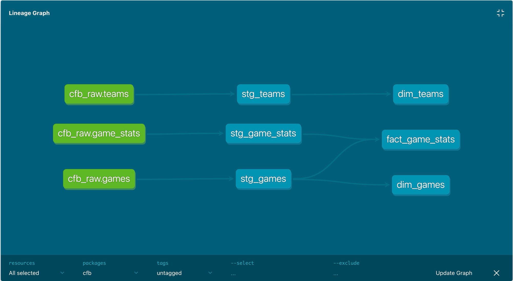
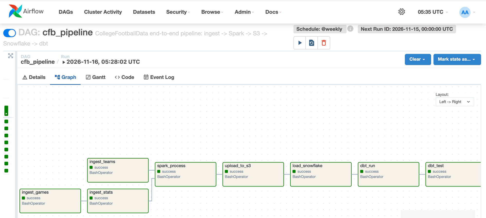

# College Football Data Pipeline

An end-to-end data engineering pipeline that ingests college football data from the
[CollegeFootballData API](https://collegefootballdata.com/), lands it in an S3 data
lake, transforms it with PySpark, loads it into Snowflake, and models it into an
analytics-ready star schema with dbt — orchestrated by Airflow.

> **Status:** The full pipeline runs end to end — API → S3 → PySpark → Snowflake → dbt —
> orchestrated by Airflow on a weekly schedule, with dbt tests enforcing data quality.
> See [Project status](#project-status).

## Architecture

```
CollegeFootballData API
      │  Python ingestion (requests)
      ▼
  data/raw/ (JSON)  ──────►  S3  raw/            (boto3)
      │
      │  PySpark (local mode) — flatten, pivot, parse, type
      ▼
  data/processed/ (Parquet)  ──────►  S3  processed/
      │
      │  Snowflake external stage + COPY INTO  (S3 storage integration)
      ▼
  Snowflake RAW  ──►  dbt: STAGING ──► ANALYTICS (star schema)
      │
      ▼
  Airflow (Docker Compose) orchestrates the full DAG
```

## Tech stack

| Layer          | Tools                                   |
| -------------- | --------------------------------------- |
| Ingestion      | Python, `requests`                      |
| Data lake      | AWS S3, `boto3`, IAM (least privilege)  |
| Processing     | PySpark (local), Parquet                |
| Warehouse      | Snowflake (S3 storage integration)      |
| Modeling       | dbt (staging → marts, tests, docs)      |
| Orchestration  | Airflow, Docker Compose                 |

## Data model (star schema)

| Table             | Grain                 | Source         |
| ----------------- | --------------------- | -------------- |
| `dim_teams`       | one row per team      | `/teams/fbs`   |
| `dim_games`       | one row per game      | `/games`       |
| `fact_game_stats` | one row per game-team | `/games/teams` |

`fact_game_stats` joins to `dim_games` on `game_id` and to `dim_teams` on `team_id`.

### dbt lineage

Raw sources → staging (typed views) → marts (star schema), built and tested with dbt:



## Orchestration (Airflow)

The whole pipeline runs as a single Airflow DAG (`cfb_pipeline`) in Docker, on a
weekly schedule with automatic retries. Each task runs one stage of the pipeline;
Airflow handles ordering, parallelism, scheduling, and monitoring.



```
ingest_teams ┐
             ├─► spark_process ─► upload_to_s3 ─► load_snowflake ─► dbt_run ─► dbt_test
ingest_games ─► ingest_stats ┘
```

## Datasets & scope

- FBS teams, games, and team game stats for **2022–2025** (completed-season backfill).
- The current season is planned as a **live, incrementally-updating source** so the
  scheduled pipeline reflects new results each week.
- Raw data is partitioned by `season` (and by `week` for stats).

## Project status

- [x] **Ingestion** — API client + per-dataset scripts, response caching, 4-season backfill
- [x] **S3 raw layer** — idempotent uploads, least-privilege IAM
- [x] **PySpark processing** — flatten nested JSON, pivot long→wide stats, parse/type → Parquet
- [x] **Processed layer in S3** — mirrored upload (idempotent across reruns)
- [x] **Snowflake load** — S3 storage integration + external stage + `COPY INTO`
- [x] **dbt** — staging + marts (star schema), 13 tests (`unique`/`not_null`/`relationships`/`accepted_values`), docs
- [x] **Airflow** — full DAG in Docker, weekly schedule + retries
- [ ] **Live current season** — season-aware caching so the schedule does weekly incremental work *(next)*

## Engineering highlights

- **Production-grade warehouse auth** — Snowflake reads S3 via a storage integration
  (scoped IAM role + external ID), not embedded keys.
- **Idempotent pipeline** — caching on ingest, mirrored processed-layer upload, and
  `TRUNCATE`+`COPY` loads mean reruns are safe. (An additive-upload bug that doubled
  rows was caught by dbt `unique` tests on the first full DAG run, then fixed at the
  root cause.)
- **Data-quality rigor** — reconciled the games and stats endpoints 1-to-1, traced
  nulls back to the source to distinguish "didn't happen" from "unknown," and handled
  real edge cases (neutral-site venues, a hurricane-cancelled game, conference
  realignment). See [`docs/data-notes.md`](docs/data-notes.md).
- **Dimensional modeling** — team-season `dim_teams` preserves realignment history;
  `fact_game_stats` scoped to FBS-vs-FBS games so every key resolves.

## Repository structure

```
ingestion/   api_client.py, ingest_teams.py, ingest_games.py, ingest_stats.py, upload_to_s3.py
spark/       process_teams.py, process_games.py, process_stats.py
snowflake/   load_raw.py   (S3 -> Snowflake RAW via external stage + COPY INTO)
dbt/         models/staging, models/marts, tests, profiles
airflow/     Dockerfile, docker-compose.yaml, dags/cfb_pipeline.py
docs/        data-notes.md, images/, samples/
data/        local raw + processed files (gitignored)
```

## Getting started

**Prerequisites:** Python 3.12, Java 11 (for PySpark), an AWS account + S3 bucket, a
Snowflake account, and a CollegeFootballData API key.

```bash
# 1. Install dependencies
python -m venv .venv && source .venv/bin/activate
pip install -r requirements.txt

# 2. Configure credentials
cp .env.example .env   # then fill in the values

# 3. Ingest raw data (per season)
python ingestion/ingest_teams.py --season 2024
python ingestion/ingest_games.py --season 2024
python ingestion/ingest_stats.py --season 2024

# 4. Upload raw to S3
python ingestion/upload_to_s3.py

# 5. Transform to Parquet with Spark
python spark/process_teams.py
python spark/process_games.py
python spark/process_stats.py

# 6. Upload processed Parquet to S3
python ingestion/upload_to_s3.py

# 7. Load S3 Parquet into Snowflake RAW
python snowflake/load_raw.py

# 8. Build + test the dbt models (staging -> marts)
set -a; source .env; set +a
dbt run  --project-dir dbt --profiles-dir dbt
dbt test --project-dir dbt --profiles-dir dbt
```

Or run the whole thing orchestrated — from `airflow/`, `docker compose up -d`, then
trigger the `cfb_pipeline` DAG at http://localhost:8080.

Ingestion caches responses locally and skips the API call if a file already exists,
to stay within the API's monthly request limit (1,000 calls/month on the free tier).

## Data quality notes

Modeling decisions and data-quality findings (e.g. neutral-site venues vs. home-team
stadiums, filtering unplayed/cancelled games, and reconciling the games and stats
endpoints) are documented in [`docs/data-notes.md`](docs/data-notes.md).

## Limitations & roadmap

- **Local Spark & single-node Airflow** — fine for this data volume; a production
  version would use a managed Spark/warehouse and a managed Airflow.
- **Infra created by hand** — the S3 bucket, IAM roles, and Snowflake objects are set
  up manually; Terraform would make this reproducible.
- **Roadmap:**
  - **Live current (2026) season** — season-aware caching so the weekly schedule does
    real incremental work as games complete.
  - **Custom metrics** (dbt) — success rate, yards per play by down, havoc rate.
  - **Streamlit dashboard** on the analytics tables.
  - **Deeper data** (play-by-play, player stats) — gated by the API's monthly call
    budget; would need a paid tier or tightly scoped backfill.
  - **Terraform** for S3/IAM and **GitHub Actions** CI for the dbt tests.

## License

MIT
